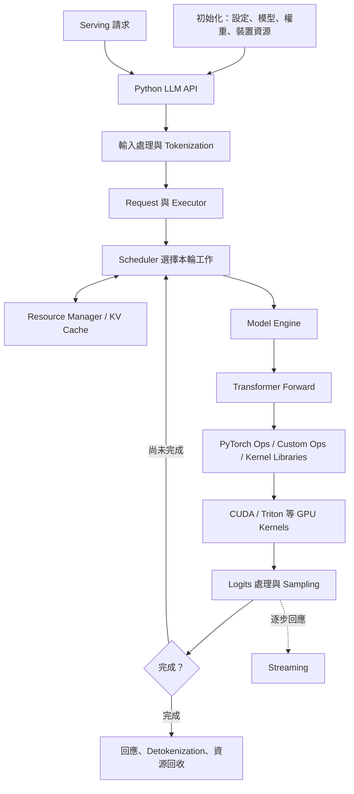

<!--
SPDX-FileCopyrightText: Copyright (c) 2026 NVIDIA CORPORATION & AFFILIATES. All rights reserved.
SPDX-License-Identifier: Apache-2.0
-->

# TensorRT-LLM 面試準備：PDF × Repo 閱讀與實作地圖

來源：[面試準備 PDF](<TensorRT LLM 面試準備.pdf>)，共 13 頁；[逐頁文字擷取](interview-preparation-pdf-extract.md)。

Repo 核對日期：2026-10-27；checkout：`e921fa39b07c669f2633ac95390fd9deac32d92b`。
本文件將 PDF 的主題與任務重新編排，補上目前 checkout 的實際檔案與閱讀切入點。
職缺是否仍開放、公開面試經驗與外部產品比較未重新查證；以下問題用來練習，不代表官方題庫。

新增的完整教材：[從 Request 到 GPU 的端到端筆記](compiler-and-flashinfer-e2e.md)，
以及 [離線互動 HTML](e2e-learning.html)。包含編譯器 13 集主題導讀、FlashInfer、attention、KV、
Graph 與多 GPU 接點；[影片清單與內容取得限制](bilibili-compiler-sources.md) 獨立保留。
概念教材維護在該 Markdown，HTML 是衍生閱讀版；唯一課程完成清單仍在本文件。

需要更新 HTML 時執行：`uv run --no-project --with markdown python build_study_notes.py`。

## 1. 先怎麼讀

學習目標是端到端理解 repo：先建立整體架構，再沿一個 request 深入，最後回到完整執行流程驗證。
建議順序：**M00 概覽 → M01 → M02 → M04 → M05 → M00 完整追蹤 → M06 → M07 → M08 → M03 → M09**。
目前已開始 M01，先保留這個進度；每次深入 C++ 或 CUDA，都先標明它在整體架構中的位置。

每次只完成一小段：

1. 讀一個觀念，再打開一個函式，確認輸入、輸出與資源 ownership。
2. 用自己的話畫資料流，先猜為什麼這樣設計。
3. 在獨立 lab 寫簡化版，先驗證 correctness。
4. 有 GPU 再 benchmark、profiling，保留數據。
5. 用兩分鐘回答「問題、作法、證據、代價」。

第一次只做 M01 的 `BufferManager` type aliases 與 constructor，不需要整份檔案讀完。

### 中文帶讀與寫作方式

採用繁體中文，結合清楚寫作、費曼式自我解釋與蘇格拉底追問。這是本課程的教學約定，
不是正式的「中文版 ASD-STE100」規範，也不代表已安裝或驗證第三方 Skills。

1. **先定位，再解釋。** 每輪先用一句話指出目前模組、上游、下游與本輪問題。
2. **一句話表達一個主要意思。** 明確寫出誰配置、誰持有、誰執行、誰釋放。
3. **術語固定。** 首次出現用「中文說明（原文）」；後續保留一致稱呼。程式 symbol 不改寫。
4. **先讓學習者說。** 一次一個問題，等回答，再找最小的理解缺口。
5. **先提示，再示範。** 若學習者說不知道或要求直接解釋，就提供必要示範，再用新情境檢查理解。
6. **把類比接回實作。** 每個類比要指出適用範圍，不能用類比代替 lifetime、ordering 或同步規則。
7. **不因精簡而省掉條件。** 保留 dtype、shape、backend、stream、ownership 與錯誤路徑等必要限制。
8. **逐步撤去提示。** 最後要求用自己的話解釋、在不同情境應用，或完成獨立 lab。

例如，避免只寫「它會自動清理」；改寫成「最後一個持有該物件的 `shared_ptr` 釋放 ownership 時，
會執行對應的銷毀流程」。接著再核對 deleter 與 GPU work 的關係。

可參考的公開資源（2026-10-27 查閱）：

- [Google 繁體中文溝通原則](https://codelabs.developers.google.com/codelabs/material-communication-guidance?hl=zh-tw)：短段落、直接表達、讓讀者重述以檢查理解；原用途為 UX 寫作，本課程只借用清楚表達原則。
- [中文費曼講解器 Skill](https://github.com/Liuziyu77/gene-skill/blob/main/examples/feynman-explainer-tool/SKILL.md)：檢查理解、縮小問題、指出類比失效點。
- [OpenMAIC 費曼學習 Skill](https://github.com/THU-MAIC/OpenMAIC/blob/main/skills/agent-runtime/feynman-learning/SKILL.md)：先解釋、補缺口、再遷移；原 Skill 依賴其課堂流程，本課程採用教學原則。
- [繁體中文寫作 Skill](https://github.com/leoluyi/skills/blob/main/skills/blog-writing-zh/SKILL.md)：適用於部落格與電子報，非 repo 原始碼帶讀的直接替代品。

### 單一事實來源（SSOT）與文件分工

SSOT 指每一類資訊有明確的權威來源，不是把所有內容塞進一個檔案。

| 資訊 | 權威來源 | 其他地方怎麼處理 |
|---|---|---|
| 實作如何運作 | 指定 checkout 的程式碼、實際設定與被選用的分支 | 筆記引用 path、symbol、查閱時行號；不能把閱讀入口當成已驗證呼叫鏈 |
| 實際執行結果 | 對應環境、workload 的測試與 profiler artifacts | 沒執行就寫未驗證，不由註解或推測補成結果 |
| 公開介面契約與設計意圖 | 對應版本的 API 文件、規格與設計紀錄 | 與實作衝突時明確記錄差異，再判斷是文件過時或實作問題 |
| 課程順序、教學約定與完成清單 | 本文件 | 其他筆記只連結，不另建一份競爭地圖或完成清單 |
| 回答、理解缺口、下一題與練習證據 | [learning-progress.md](learning-progress.md) | 每輪接續這份紀錄；保留原始回答與修正的區別 |
| 原始面試準備材料 | PDF 與逐頁擷取版 | 作為來源保留，不拿來覆蓋當前 repo 行為 |

換 checkout 後重新核對 symbol 與分支。若靜態閱讀無法確定，標記「待追蹤」；
閱讀過檔案不等於具備獨立解釋或實作能力。

### 端到端架構主線

第一條路徑選擇：decoder-only 文字生成、單 GPU、普通自回歸 decoding。
先追 Python LLM API，再接 serving；先選非 overlap 路徑理解，再對照實際預設與 overlap 分支。
這是教學選擇，不表示目前 runtime 預設關閉 overlap。



這是資料與控制流程的概念圖，不是直接函式呼叫圖；各條邊在課程中逐段驗證。
資源回收與回應交付的具體時序也須沿實作確認。
目前的 [PyTorch 架構文件](docs/source/torch/arch_overview.md) 明確指出 PyTorch 為唯一執行 backend；
[總覽圖](.github/tava_architecture_diagram.md) 仍包含 TensorRT engine 路徑，閱讀時要搭配
[backend 移除說明](docs/source/legacy/tensorrt-backend-removal.md)，不要把歷史路徑當作當前主線。

| 階段 | 真實閱讀入口 | 要追的資料與邊界 | 對應任務 |
|---|---|---|---|
| 初始化 | [llm_args.py](tensorrt_llm/llmapi/llm_args.py)、[llm_utils.py](tensorrt_llm/llmapi/llm_utils.py)、[model_loader.py](tensorrt_llm/_torch/pyexecutor/model_loader.py) | 設定如何影響模型、backend 選擇與資源；區分建構期與每 request 成本 | M00 |
| API 與輸入 | [llm.py](tensorrt_llm/llmapi/llm.py)、[tokenizer.py](tensorrt_llm/llmapi/tokenizer.py) | prompt、token IDs、sampling 設定與輸出物件 | M00 |
| Request 與執行迴圈 | [llm_request.py](tensorrt_llm/_torch/pyexecutor/llm_request.py)、[py_executor.py](tensorrt_llm/_torch/pyexecutor/py_executor.py) | request state、排隊、prefill/decode iteration、完成條件 | M00/M03 |
| Scheduler 與資源 | [scheduler.py](tensorrt_llm/_torch/pyexecutor/scheduler/scheduler.py)、[resource_manager.py](tensorrt_llm/_torch/pyexecutor/resource_manager.py) | admission、token budget、KV allocation/reuse/free；再追實際 C++ binding 或 v2 分支 | M07 |
| Model Engine | [model_engine.py](tensorrt_llm/_torch/pyexecutor/model_engine.py) 的 `PyTorchModelEngine.forward` | scheduled requests 如何轉成模型輸入、metadata 與 GPU 執行 | M00/M06 |
| 模型與算子 | [modeling_llama.py](tensorrt_llm/_torch/models/modeling_llama.py)、[modules](tensorrt_llm/_torch/modules/) | 選一層追 norm → attention → MLP，標出 shapes、dtype、KV 讀寫與 dispatch | M02/M08 |
| GPU 資源與 kernel | [bufferManager.h](cpp/include/tensorrt_llm/runtime/bufferManager.h)、[rmsnormKernels.cu](cpp/tensorrt_llm/kernels/rmsnormKernels.cu)、[fused_relu2_triton.py](tensorrt_llm/_torch/fused_relu2_triton.py) | ownership、stream ordering、launch、memory access；這些是選讀案例，不保證每個模型都呼叫 | M01/M04/M05/M08 |
| Sampling 與回應 | [sampler.py](tensorrt_llm/_torch/pyexecutor/sampler/sampler.py)、[llm.py](tensorrt_llm/llmapi/llm.py) | logits → token、停止條件、streaming、detokenization 與資源釋放 | M00/M05/M07 |
| Serving 與效能 | [openai_server.py](tensorrt_llm/serve/openai_server.py)、[perf-analysis.md](docs/source/developer-guide/perf-analysis.md) | HTTP 到生成流程的接點、取消、並發、TTFT/TPOT 與 profiler | M03/M09 |

### 由主線擴展到整個 repo

端到端不是每個檔案都讀一遍。先完成可解釋、可驗證的主線，再逐項改變條件：

| 擴展情境 | 閱讀入口 | 要回答的架構變化 |
|---|---|---|
| 多 requests、長 context | [scheduler 文件](docs/source/torch/scheduler.md)、[KV cache 文件](docs/source/features/kvcache.md) | batching、chunked prefill、容量、reuse 與公平性 |
| Graph / compile | [compile 與 graph 文件](docs/source/features/torch_compile_and_piecewise_cuda_graph.md) | capture、shape、位址穩定性與 eager fallback |
| 量化 | [quantization 文件](docs/source/features/quantization.md) | 權重格式、scales、算子選擇、準確度與頻寬 |
| TP / PP / EP 與 MoE | [parallel strategy](docs/source/features/parallel-strategy.md)、[MoE guide](tensorrt_llm/_torch/moe/fused_moe/MOE_DEVELOPER_GUIDE.md) | 模型／資源的分片、通訊與負載分配 |
| Speculative decoding | [speculative decoding 文件](docs/source/features/speculative-decoding.md) | draft/verify 如何改變 iteration、sampling 與 KV 管理 |
| Disaggregated serving | [disaggregation 文件](docs/source/features/disagg-serving.md) | prefill/decode 分離、KV transfer、request 狀態 |
| 新模型支援 | [adding new model](docs/source/torch/adding_new_model.md) | registry、config、loader、model forward 與測試的接點 |
| VisualGen 垂直系統 | [engineering criteria](tensorrt_llm/_torch/visual_gen/ENGINEERING_CRITERIA.md)、[內部實作](tensorrt_llm/_torch/visual_gen/) | 另追 pipeline → denoise → VAE → 輸出，辨認與 LLM 共用的 ops；它不是 LLM backend |

每個擴展都先畫「與基準路徑差在哪裡」，再讀實作；不在第一輪同時展開所有分支。

### 每課固定節奏與端到端驗收

每輪對話只做一個核心觀念與一題；下列項目跨多輪完成，不一次全部出題：

1. **定位：** 現在位於哪個模組，處理哪個階段的資料。
2. **閱讀：** 一小段真實程式碼，附查閱當下的 path、symbol、行號。
3. **推理：** 先回答一個 ownership、資料流、同步或成本問題。
4. **驗證：** 回到程式碼、獨立 lab 或既有測試確認；未跑項目明記未驗證。
5. **回接：** 說出這個設計如何影響 request 的正確性、資源或 latency。
6. **紀錄：** 更新學習紀錄；達成該任務驗收才勾選本文件的完成清單。

完成主線時，要能從一個 prompt 開始，逐段指出 token IDs、request state、scheduled batch、
KV blocks、model tensors、logits、sampled tokens 與文字輸出的來源及去向。
再追一個取消或失敗路徑，確認資源生命週期；最後用同一 workload 串起 correctness、
單 kernel benchmark 與端到端指標。環境不支援的部分記錄阻礙與待執行項目，不宣稱已完成。

## 2. 知識地圖與優先級

| 領域 | 先學的內容 | 後續深入 | 優先級 |
|---|---|---|---|
| C++ 語言 | const、reference、value category、RAII、move、smart pointer | forwarding、RVO/NRVO、type traits | P0 |
| C++ systems | ownership、lifetime、alignment、mutex、condition variable | atomic、memory ordering、false sharing | P0 |
| CUDA programming | grid/block/thread、launch、memory、stream、event | graph、async allocation | P0 |
| GPU architecture | warp、coalescing、shared memory、bank conflict | occupancy、register spilling、Tensor Core | P0 |
| 平行演算法 | reduction、scan、transpose、softmax | RMSNorm、GEMM、attention | P0 |
| LLM inference | prefill/decode、GQA、KV cache、sampling | speculative decoding、MoE | P0 |
| Serving runtime | scheduling、continuous batching、request lifecycle | chunked prefill、overlap、disaggregation | P0 |
| Performance | latency、bandwidth、Roofline、Nsight | quantization、TP/PP/EP、communication | P0 → P1 |
| Distributed training | 基本概念 | 依職缺需求再深入 | P2 |

## 3. 這個 repo 的 kernel 在哪裡

目前掃描到 348 個 `.cu`、74 個 `.cuh`；包含測試及模板實例化，不能直接當作不同 kernel 的數量。
`tensorrt_llm/` 下有 84 個 Python 檔案含 `@triton.jit`，也不能直接當作 kernel 數量。

| 類型 | 入口 | 建議用途 |
|---|---|---|
| CUDA C++ | [cpp/tensorrt_llm/kernels](cpp/tensorrt_llm/kernels/) | normalization、sampling、quantization、communication |
| CUDA attention | [cpp/kernels](cpp/kernels/) | XQA、FMHA，基礎打穩後再讀 |
| Triton 小範例 | [fused_relu2_triton.py](tensorrt_llm/_torch/fused_relu2_triton.py) | indexing、mask、fusion、dtype、aliasing |
| Triton attention | [triton_prefill.py](tensorrt_llm/_torch/attention/backends/triton_prefill.py) | tiled attention 資料流 |
| Triton MoE | [fused_moe_triton.py](tensorrt_llm/_torch/moe/fused_moe/fused_moe_triton.py) | routing 與進階融合 |
| VisualGen CUDA | [fusedDiTQKNormRopeKernel.cu](cpp/tensorrt_llm/kernels/fusedDiTQKNormRopeKernel.cu) | DiT QK normalization 與 RoPE 融合 |
| VisualGen Triton | [triton_kernels](tensorrt_llm/_torch/visual_gen/triton_kernels/) | resize、canny、bilateral |

`triton_backend/` 是 NVIDIA Triton Inference Server 整合；上面 `@triton.jit` 使用的是 Triton GPU programming language。

## 4. PDF 與目前 checkout 的差異

| PDF 提到的入口 | 目前核對結果 | 本文件怎麼使用 |
|---|---|---|
| `samplingTopPKernels.cu` | 目前 checkout 沒有這個檔案 | 改讀 `fusedSamplingSingleCta.cu` 與 common header，學 reduction、scan、launch；不假設兩者實作等價 |
| `fusedLayernormKernels/ws_layernorm.cuh` | 存在，但涉及較複雜的 traits 與硬體實作 | 先讀 `rmsnormKernels.cu`，再進階 |
| `triton_kernels/` | 不能當作單一通用入口 | 從短小的 `fused_relu2_triton.py` 開始 |
| `kvCacheManager.cpp` | 原路徑存在，另有 `kv_cache_manager_v2/` | 先追 scheduler 實際選用的 manager，再決定讀哪版 |
| `this auto&&` | PDF 已提醒為 C++23 功能 | 與 C++17/20 基礎分開複習，不假設專案所有 target 都可使用 |

## 5. M00：Repo Architecture Walkthrough

**對應 PDF：第 4、9、10 頁。目標：說出 request 如何變成生成的 tokens。**

閱讀入口：

- [llm.py](tensorrt_llm/llmapi/llm.py)：`BaseLLM.generate`（核對時第 691 行）、`generate_async`（796）。
- [py_executor.py](tensorrt_llm/_torch/pyexecutor/py_executor.py)：`_executor_loop`（4836）、`_schedule`（7197）、`_forward_step`（8368）。
- [架構概覽](docs/source/torch/arch_overview.md)。

這是概念圖，實際中間層與分支要沿呼叫確認：

```text
LLM API → request / executor
        → scheduling + KV resources
        → model forward → sampling
        → response / streaming → release resources
```

**練習：** 選普通、非 disaggregated 的文字生成路徑，畫出五到十個節點。
標出 CPU 工作、GPU 工作、可能等待的地方。

**驗收：** 能解釋 prefill/decode 哪些步驟共用、哪些資源持續存在。

**追問：** 為什麼使用 PyTorch model authoring 的 inference engine，仍會需要 C++ 與自訂 GPU kernels？

## 6. M01：C++ RAII 與 GPU Buffer Ownership

**對應 PDF：第 9、10、12 頁。這是第一課。**

按順序讀：

1. [bufferManager.h](cpp/include/tensorrt_llm/runtime/bufferManager.h)：`BufferManager`（42），`IBufferPtr`、`ITensorPtr`、`CudaStreamPtr`。
2. [bufferManager.cpp](cpp/tensorrt_llm/runtime/bufferManager.cpp)：constructor 中的 `std::move(stream)`（34）、`gpu` allocation 路徑。
3. [iBuffer.h](cpp/include/tensorrt_llm/runtime/iBuffer.h)：`IBuffer`（369）、`UniquePtr`（372）、virtual destructor（486）。
4. [cudaStream.h](cpp/include/tensorrt_llm/runtime/cudaStream.h)：`CudaStream`（31）與 `Deleter`（111）。
5. [bufferManagerTest.cpp](cpp/tests/unit_tests/runtime/bufferManagerTest.cpp)：對照現有使用方式與測試。

**先理解：** `unique_ptr` 管理單一 ownership；`shared_ptr` 共用物件生命週期。
智慧指標本身不會自動建立跨 CUDA streams 的執行相依性。
`std::move` 是 value category 轉換，是否轉移資源由後續呼叫決定。

**練習：** 自己設計簡化的 `DeviceBuffer`，先用同步 allocation/free：

- 禁止 copy，允許 move；moved-from 物件維持可析構狀態。
- move assignment 要先處理原本資源，並考慮 self-move。
- allocation 失敗不洩漏；destructor 不向外拋例外。
- 完成同步版後，再思考如何讓 async 版保有 stream lifetime。

**驗收：** 畫出 A move 到 B 前後的 pointer ownership；驗證 double-free、self-move 與失敗路徑。

**追問：** C++ destructor 返回，是否代表 GPU 已經不使用這塊記憶體？
回答要區分 host object lifetime、stream ordering、GPU work completion。
跨 stream 的最後使用與釋放必須有正確 dependency，不能只依賴 host scope。

**第一個要自己回答的問題：** 為什麼這裡 buffer 用 `unique_ptr`，stream 用 `shared_ptr`？
先從使用與保存它們的位置提出假設，再沿定義驗證。

## 7. M02：C++ Templates、Const 與編譯期選擇

**對應 PDF：第 8～11 頁。**

閱讀：

- [executor.h](cpp/include/tensorrt_llm/executor/executor.h)：選一個小型設定或 request 介面，辨認 value、reference、const 與 optional。
- [fusedSamplingSingleCta.cu](cpp/tensorrt_llm/kernels/fusedSampling/fusedSamplingSingleCta.cu)：`fusedSamplingKernel`（40）、`launchFusedSampling`、`if constexpr`（75）。
- 進階：[ws_layernorm.cuh](cpp/tensorrt_llm/kernels/fusedLayernormKernels/ws_layernorm.cuh) 的 `Traits` 與 `if constexpr`。

**練習：** 從 `BLOCK`、`NEED_TOKENS`、`NEED_PROBS` 追一個 specialization。
標出哪些條件編譯期決定、哪些仍在 runtime 選擇。

**驗收：** 能解釋 `T const*`、`T* const`、`T const&`；分辨普通 rvalue reference 與 forwarding reference。
知道 C++17 特定 prvalue 的 copy elision 有保證，NRVO 不一概保證。

**追問：** 為何用 template boolean 生成不同 kernel，而不只在 kernel 裡放 runtime `if`？代價是什麼？

## 8. M03：C++ Concurrency 與資源池

**對應 PDF：第 4、8、11 頁。**

先讀較小的 [ExecPool.cpp](cpp/tensorrt_llm/executor/cache_transmission/nixl_utils/bounce/ExecPool.cpp)：
`tryAcquire`（109）與 `release`，觀察 `lock_guard`、free-list 與資源生命週期。
這是 KV transfer 的 execution-context pool，用來學同步模式；不是整個 inference scheduler。

**練習：** 寫 CPU-only bounded queue，具備 push、pop、shutdown。
使用 mutex 與帶 predicate 的 condition-variable wait，說清楚 shutdown 後 queue 裡的資料如何處理。

**驗收：** 多 producer/consumer 不丟資料；shutdown 可喚醒等待者；不在持鎖狀態 join 需要同把鎖的 thread。

**追問：** lock_guard 離開 scope 後，取出的物件是否就不再需要 lifetime 保護？

## 9. M04：CUDA Memory 與 Matrix Transpose

**對應 PDF：第 2、3、6、10、12 頁。先自己寫小實驗。**

先做 vector add，確認 indexing、bounds check 與 grid-stride loop，再做 transpose：

| 版本 | 作法 | 要觀察的事情 |
|---|---|---|
| V1 | 直接 transpose | load/store 哪一邊是 stride access |
| V2 | shared-memory tiled transpose | global load/store 是否更連續；同步是否正確 |
| V3 | shared tile 加 padding | 在指定型別與存取模式下，bank mapping 怎樣改變 |

`tile[32][33]` 是典型 32-bit 元素 transpose 教材，不能直接推廣為任何型別、任何 access pattern 都沒有 conflict。

**練習形狀：** 256×256、1024×1024、2048×2048、1003×769。
先對照 CPU 結果，再用 CUDA events 測量，排除 allocation、H2D/D2H 與首次執行成本。
若以每個元素一次讀、一次寫計算，effective bandwidth 為 `2 × 元素數 × sizeof(T) / 秒數`。

回到 repo 對照 [rmsnormKernels.cu](cpp/tensorrt_llm/kernels/rmsnormKernels.cu) 的 `__global__`、thread indexing 與 launch。

**驗收：** 用一個 warp 的位址推導 coalescing；用 bank index 解釋 padding；不能只說 shared memory 比較快。

**追問：** shared memory 若只增加一次 copy 與 synchronization，為何可能更慢？occupancy 高一定更快嗎？

## 10. M05：Reduction、Scan 與 Sampling

**對應 PDF：第 2、4、6、10、11 頁。**

閱讀：

- [rmsnormKernels.cu](cpp/tensorrt_llm/kernels/rmsnormKernels.cu)：`generalRmsNorm`（55）、launch（207 附近）。
- [fusedSamplingSingleCta.cu](cpp/tensorrt_llm/kernels/fusedSampling/fusedSamplingSingleCta.cu)：shared state、block 配置、launch specialization。
- [fusedSamplingKernelsCommon.cuh](cpp/tensorrt_llm/kernels/fusedSampling/fusedSamplingKernelsCommon.cuh)：`BlockReduce`、`BlockScan`（536 附近），再追使用它們的程式段。

**練習順序：** block sum → warp shuffle reduction → multi-block reduction → prefix scan → stable softmax。
multi-block 階段使用明確的分段策略，例如兩次 launch；不要假設 `__syncthreads()` 能同步不同 blocks。

**驗收：** 測試非 block 整數倍、不同長度、不同值域；softmax 先減 row max，說明浮點加總順序的誤差。
比較 PyTorch 時使用相同 dtype 與輸出語意，記錄短向量與長向量的差異。

**追問：** 為什麼 reduction 比 `torch.sum` 慢三倍？先確認測量、shape、launch 數量，再查 bandwidth、同步與 register usage。

## 11. M06：CUDA Streams 與 Graphs

**對應 PDF：第 4、5、11 頁。**

閱讀：

- [cudaStream.h](cpp/include/tensorrt_llm/runtime/cudaStream.h)。
- [cuda_graph.py](tensorrt_llm/_torch/pyexecutor/engine/cuda_graph.py)：batch-size/token-count 的 graph 選擇與輔助函式。
- [cuda_graph_runner.py](tensorrt_llm/_torch/pyexecutor/cuda_graph_runner.py)：capture/replay 入口。
- [torch.compile 與 piecewise CUDA graph 文件](docs/source/features/torch_compile_and_piecewise_cuda_graph.md)。

**練習：** 畫出 H2D → kernel → D2H 的 dependencies；再比較 eager launches 與 graph replay。
先固定 shape，再思考不同 batch size、buffer 位址與 capture 成本。

**驗收：** 分開量測 GPU execution 與 host launch overhead；解釋 event wait 和 device-wide synchronization 的差異。

**追問：** CUDA Graph 為何可能改善 decode latency？動態 request 為何需要 graph selection 或 padding？

## 12. M07：Scheduler 與 KV Cache

**對應 PDF：第 3、4、11～13 頁。**

閱讀：

- [scheduler.py](tensorrt_llm/_torch/pyexecutor/scheduler/scheduler.py)：`CapacityScheduler`（437）、`BindCapacityScheduler`（450）、`MicroBatchScheduler` 定義與使用。
- [py_executor.py](tensorrt_llm/_torch/pyexecutor/py_executor.py)：`_schedule`（7197）及其呼叫的 scheduler/resource manager。
- [kvCacheManager.cpp](cpp/tensorrt_llm/batch_manager/kvCacheManager.cpp)：`BlockManager`、`WindowBlockManager`。
- [KV cache 文件](docs/source/features/kvcache.md)。

檔案裡有多個 `MicroBatchScheduler` 定義或相關包裝，請沿建立物件的位置確認實際型別。
repo 也有 [KV manager v2](cpp/tensorrt_llm/batch_manager/kv_cache_manager_v2/)；不要混用不同 manager 的不變量。

**先手算容量：** 對標準、各 layer 設定相同的完整 K/V cache：

```text
KV bytes = 2 × layers × batch × sequence_length × KV_heads × head_dim × bytes_per_element
```

這是簡化模型，不含 padding、metadata、量化 scales、跨 GPU 分片與特殊 cache 架構。
GQA 減少 KV heads；paged allocation 主要改變配置、碎片與 reuse 行為，不會自動減少每個有效 token 的 K/V 元素數。

**練習：** 用每 block 16 tokens、總共 256 blocks、每 iteration 最多處理 256 tokens 的教學規則：

| Request | Prompt tokens | 要生成的 tokens |
|---|---:|---:|
| A | 128 | 64 |
| B | 2048 | 128 |
| C | 512 | 32 |

先自行定義 admission 與 decode 優先規則，再逐輪追 prefill、decode、block allocation 與完成釋放。
這些規則是 lab 設定，不代表 production 的 scheduler policy。

**驗收：** 能區分「資源能否容納」與「本 iteration 執行誰」，並說明長 prompt 對 TTFT/TPOT 的影響。

**追問：** prefix reuse 怎樣影響 reference count 與 eviction？request cancellation 後哪些資源不能立即回收？

## 13. M08：RMSNorm 與 Triton Optimization

**對應 PDF：第 6、10、11 頁。**

先讀 [fused_relu2_triton.py](tensorrt_llm/_torch/fused_relu2_triton.py)：
`_relu2_kernel`（26）、`is_eligible`（37）、`fused_relu2`（46）。

這個例子可以一次學到：

- `program_id`、`arange`、mask 與 `tl.constexpr`。
- load → fp32 calculation → cast/store；NaN propagation。
- contiguous layout 假設、output validation 與 partial-overlap 問題。
- 將 ReLU 與平方融合，減少 eager intermediate tensor 的讀寫。

接著讀 [rmsnormKernels.cu](cpp/tensorrt_llm/kernels/rmsnormKernels.cu)，自己做簡化 Triton RMSNorm。
再選讀 [triton_prefill.py](tensorrt_llm/_torch/attention/backends/triton_prefill.py) 的 `_fwd_kernel`（103）。

**驗收：** 與 PyTorch reference 比較；記錄 dtype、shape、容許誤差，考慮不同 hidden sizes。
測試極端值、非 tile 整數倍、輸入 layout 與 aliasing 的支援邊界。
自己測量後才下效能結論，不把 repo 註解裡特定 GPU 的數字當作自己的結果。

**追問：** 融合省下哪些 memory traffic？為什麼某些 shape 反而變慢？register pressure 與 padding 成本如何影響結果？

## 14. M09：Nsight 與 Performance Case Study

**對應 PDF：第 5、6、11、13 頁。**

閱讀 [Performance Analysis](docs/source/developer-guide/perf-analysis.md) 與
[Benchmarking Guide](docs/source/developer-guide/perf-benchmarking.md)。

**工作流程：** correctness → warmup → baseline → Nsight Systems → 選定 kernel → Nsight Compute → 假設 → 一次改一件事 → 重測。

| 觀察 | 下一步要驗證的假設 |
|---|---|
| GPU timeline 有大片空白 | CPU launch、同步、資料準備或 scheduling 等待 |
| bandwidth 接近可達上限 | 是否能減少 bytes、融合或提高資料重用 |
| bandwidth 與 compute 都低 | workload 太小、dependency、latency 或存取模式 |
| register 使用量很高 | occupancy 限制、spill 與 ILP 的權衡 |
| kernel 變快但端到端無改善 | 該 kernel 佔比、其他瓶頸、額外 overhead |

**驗收：** 一份可重現報告：GPU/環境、shape/dtype、baseline、修改、correctness、latency 分布、profiler 證據、端到端影響與限制。

**追問：** 佔總時間 10% 的 kernel 快兩倍，其他成本不變，理想端到端加速是多少？

## 15. PDF 的 32 題複習表

以下保留 PDF 的問題範圍，配合前面的課程逐題練習。

| # | 問題 | 回答至少包含 | 任務 |
|---|---|---|---|
| 1 | Memory coalescing 是什麼？ | warp 位址、alignment、memory requests | M04 |
| 2 | Global/shared/register/local 差異？ | 存放位置、lifetime、spill | M04 |
| 3 | Shared memory bank conflict？ | bank mapping、broadcast、padding 條件 | M04 |
| 4 | Parallel reduction 怎麼做？ | shuffle、block、跨 block、誤差 | M05 |
| 5 | 如何優化 transpose？ | global load/store、tile、padding | M04 |
| 6 | Occupancy 越高越好嗎？ | latency hiding、register、ILP | M09 |
| 7 | Tiled GEMM 怎麼做？ | reuse、tile、shared/register、Tensor Core | 延伸 |
| 8 | Warp divergence 原因？ | warp 內分支、predication、工作分布 | M04 |
| 9 | Prefill 與 decode 差異？ | shape、KV access、batch 與瓶頸 | M00/M07 |
| 10 | 推導 KV cache 容量 | layers、KV heads、dtype、sequence length | M07 |
| 11 | MHA/MQA/GQA 差異？ | KV heads、共享與頻寬 | M07 |
| 12 | FlashAttention 怎麼運作？ | tiling、online softmax、不保存完整 attention matrix | M08 延伸 |
| 13 | PagedAttention 是什麼？ | logical/physical blocks、碎片與 reuse | M07 |
| 14 | Speculative decoding？ | draft、verification、acceptance、額外成本 | 延伸 |
| 15 | Decode 為何常 memory-bound？ | arithmetic intensity、weights/KV、batch | M09 |
| 16 | MoE inference 有何不同？ | routing、expert balance、GEMM、communication | 延伸 |
| 17 | Static/continuous batching？ | iteration 級 admission/completion | M07 |
| 18 | 設計 KV cache manager | pool、mapping、refcount、eviction、OOM | M07 |
| 19 | Chunked prefill？ | token budget、長 prompt、TTFT/TPOT | M07 |
| 20 | CUDA Graph 為何幫助 decode？ | launch overhead、capture/replay、動態 shapes | M06 |
| 21 | 設計高吞吐 LLM server | queue、scheduler、execution、sampling、streaming | M00/M07 |
| 22 | 為何分離 prefill/decode？ | 資源特性、干擾、KV transfer 代價 | 延伸 |
| 23 | TTFT/TPOT/throughput？ | 量測範圍、p50/p99、負載條件 | M09 |
| 24 | 比較 inference frameworks | 在同 workload 下比較 runtime、kernel 與部署限制 | 延伸；須另查當前版本 |
| 25 | Serialize/deserialize tree | null markers、DFS/BFS、O(N) | C++ 額外練習 |
| 26 | Parallel prefix sum | work efficiency、同步、跨 block | M05 |
| 27 | Thread-safe queue | mutex、wait predicate、shutdown | M03 |
| 28 | RAII/move/Rule of Five | ownership、lifetime、exception safety | M01 |
| 29 | Streams 與 synchronization | ordering、events、host/device wait | M06 |
| 30 | 如何 debug 慢 kernel？ | 測量 → timeline → kernel metrics → 假設 | M09 |
| 31 | FP16/BF16/FP8/INT4 差異？ | range、precision、scale、accumulation、硬體 | 延伸 |
| 32 | 如何證明優化有效？ | correctness、公平 baseline、重現、端到端 | M09 |

## 16. 六週安排與進度

每週約 6～10 小時，可依程度延長；保留 C++ 與 CUDA 交錯練習。

| 週 | 重點 | 交付物 |
|---|---|---|
| 1 | M01、M04 | ownership 圖、GPU buffer 草稿、transpose 三版 |
| 2 | M02、M05 | template 分析、reduction/scan/softmax correctness |
| 3 | M00、M08 入門 | request flow、ReLU² 解說、attention 資料流 |
| 4 | M06、M07 | stream dependencies、KV allocation 手算、serving metrics |
| 5 | M08、M09 | RMSNorm benchmark、profiler 分析；再補 GEMM/quantization |
| 6 | M03、模擬面試 | queue、兩分鐘專案故事、兩場 mock interview |

- [ ] M00 Architecture
- [ ] M01 RAII / Ownership
- [ ] M02 Templates / Const
- [ ] M03 Concurrency
- [ ] M04 CUDA Memory / Transpose
- [ ] M05 Reduction / Scan / Sampling
- [ ] M06 Streams / Graphs
- [ ] M07 Scheduler / KV Cache
- [ ] M08 RMSNorm / Triton
- [ ] M09 Profiling Case Study

沒有 GPU 時，可以先讀 code、畫圖、做 CPU queue 與 KV 模擬；CUDA correctness 與效能項目保留待驗證。
需要模型權重的測試必須設定 `LLM_MODELS_ROOT`，先確認 GPU、build 與依賴可用。

## 17. 給 Codex 的帶讀 Prompt

```text
請按照 interview-preparation.md 帶我準備 TensorRT-LLM 面試。
先讀適用的 AGENTS.md / CLAUDE.local.md，核對目前 checkout。
再讀 learning-progress.md，從尚未回答的問題或待驗證項目接續，不重設進度。
以繁體中文帶讀，目標是沿完整 request 流程理解 repo。

教學規則：
1. 一次只解釋一個觀念，提出一個問題，等我回答後繼續。
2. 用真實檔案、symbol 與當前行號解釋，不只給通用定義。
3. 先讓我推理或嘗試實作，再給提示；不要直接完成整份答案。
4. 實作使用獨立 lab，遵守 repo 規範。
5. 先驗證 correctness，再 benchmark；沒跑過就標記未驗證。
6. 每課整理閱讀範圍、我的回答、待補觀念、練習與面試追問。
7. 我能獨立解釋並完成驗收後，才勾選該項進度。
8. 每輪先標明架構位置、上游與下游，結束時把局部觀念接回端到端流程。
9. 回答與證據更新 learning-progress.md；完成清單只維護在本文件。

第一步：打開 bufferManager.h 的 pointer aliases 與 constructor，
問我 buffer 與 stream 的 ownership 為什麼可能採用不同設計。
```

## 18. 每次練習留下的筆記

```text
任務 / 日期：
Checkout / GPU / 環境：
讀了哪些檔案與函式：
要解決的問題：
我的理解與實作：
Correctness / edge cases：
Benchmark 方法、shape、dtype、warmup：
Baseline / 修改後結果：
Profiler 證據：
Trade-off / 尚未驗證的地方：
兩分鐘面試說明：
下一步：
```
